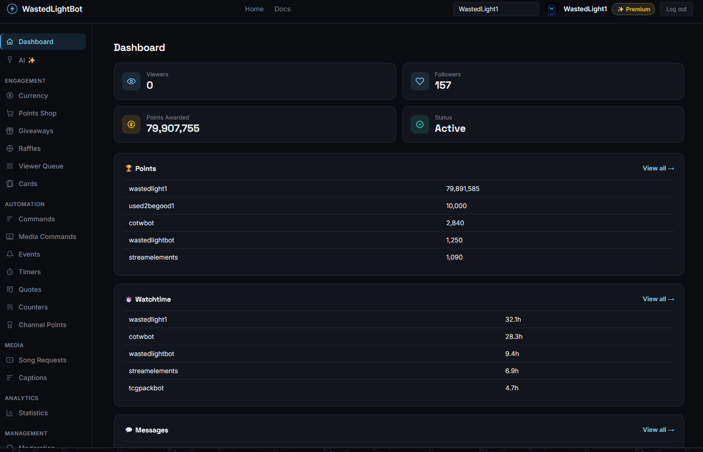
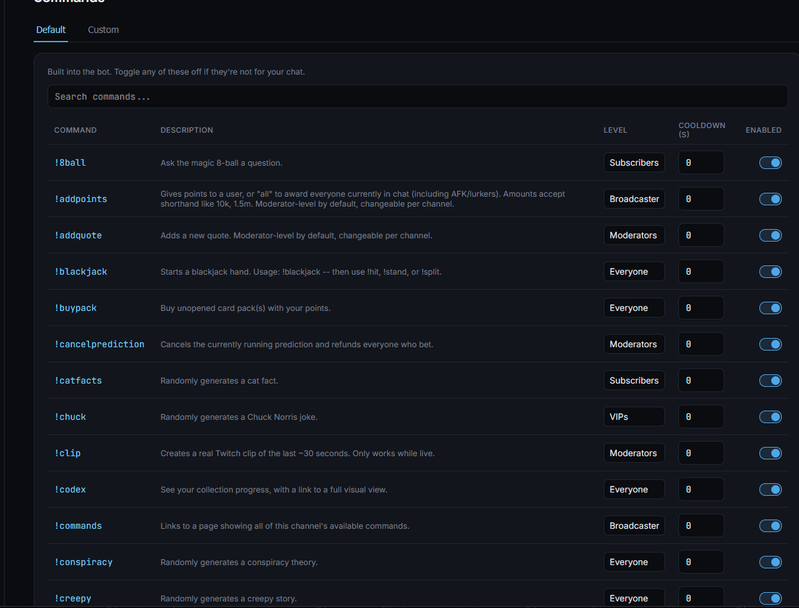
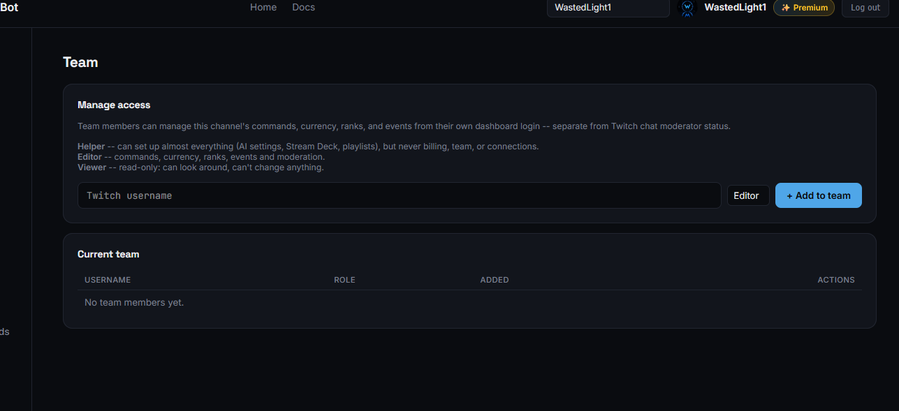

# WastedLight Bot

  

  **More than a chat bot. A management platform for streaming communities.**

  
  
  

---

## About the Project

**WastedLight Bot** is an independently developed Twitch community bot and web-based management platform.

Designed to give streamers greater control over their communities, the platform combines interactive bot functionality with a central dashboard for managing commands, engagement features, channel settings and team access.

Rather than relying entirely on chat commands, WastedLight Bot provides a dedicated interface where channel owners and authorised team members can manage their bot.

## Key Features

### Dashboard & Analytics

A central dashboard providing an overview of channel activity and community engagement.

- Viewer and follower statistics
- Points awarded and community activity
- Bot status monitoring
- Points leaderboards
- Watch-time leaderboards
- Message statistics

### Command Management

A configurable command management system allowing channel owners to control how their bot behaves.

- Default and custom commands
- Custom command descriptions
- Individual permission requirements
- Configurable cooldowns
- Enable and disable controls
- Command searching and management

### Team & Permissions

A team management system allowing channel owners to delegate dashboard access without sharing their account.

- Invite team members using their Twitch username
- Role-based access control
- Editor, Helper and Viewer roles
- Separate permissions for different management tasks
- Dashboard access independent of Twitch moderator status

### Community Engagement

Tools designed to encourage community participation and interaction.

- Points and rewards
- Leaderboards
- Watch-time tracking
- Interactive commands
- Community-focused features

## Screenshots

### Dashboard

The main dashboard provides an overview of channel statistics, community engagement and bot activity.

### Command Management

Manage default and custom commands, configure permissions, set cooldowns and control which commands are enabled.

### Team Management

Give trusted team members access to channel management tools through configurable roles and permissions.

## Platform Support

| Platform | Availability |
|---|---|
| Twitch | Available |
| Kick | In development |
| YouTube | In development |

## Technology

WastedLight Bot is an independently developed software project involving:

- JavaScript
- Node.js
- Twitch API integrations
- Backend development
- Database-backed functionality
- Web dashboard development
- Role-based access management

## Project Links

- **Website:** https://wastedlightbot.com
- **GitHub:** https://github.com/wastedlight

## About This Repository

This repository is a public portfolio showcase of WastedLight Bot.

It contains project documentation and selected screenshots. The application's source code, internal infrastructure and private configuration are not included.

WastedLight Bot is independently developed and maintained by WastedLight.

## Contact

Interested in the project or want to discuss development?

- GitHub: [@wastedlight](https://github.com/wastedlight)
- Discord: `_wastedlight`

---

  **WastedLight Bot**
   
  <i>Building better communities, one feature at a time.</i>

